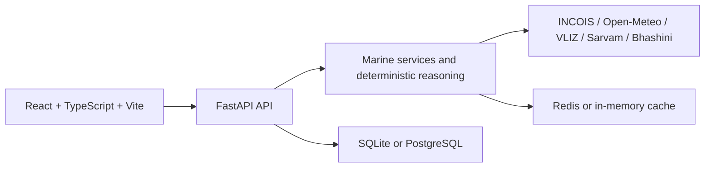

# ORCA Marine AI

ORCA Marine AI is a decision-support platform for coastal mariners and fisheries
operations. It combines marine conditions, fishing-zone intelligence, boundary
awareness, multilingual assistance, and emergency guidance in one responsive
web application.

The project is designed for the Smart India Hackathon (SIH) prototype and final
demonstration. It is not a replacement for official navigation, weather,
maritime safety, or search-and-rescue services.

## Product overview

ORCA helps a user answer practical questions such as:

- Is it operationally safe to go to sea from my selected location?
- What marine conditions and forecast trends should I consider?
- Where are nearby Potential Fishing Zones (PFZs)?
- Am I approaching an EEZ, IMBL, or protected-area boundary?
- Can I receive the advisory in a regional Indian language?
- What information should be included in an emergency MAYDAY message?

The interface includes a dashboard, tactical map, conversational assistant,
alerts, marine services, location selection, settings, and role-aware
administration views.

## Current status

This repository contains a working prototype with live-provider adapters,
deterministic demo scenarios, and explicit provenance indicators.

| Area | Status |
| --- | --- |
| Frontend production build | Passing (`tsc -b && vite build`; entry ~73 kB, largest chunk ~221 kB) |
| Frontend automated tests | 170 passing across 32 test files (Vitest) |
| Frontend lint | Passing (`oxlint --deny-warnings`, 0 errors, 0 warnings) |
| Backend automated tests | 547 passing, 5 skipped (`@pytest.mark.external`), 0 failures (`pytest`) |
| Tooling release checks | 4 passing (`tools/test_release_check.py`) |
| Chat transient-failure retry | Implemented and tested |
| Assistant-to-map return navigation | Implemented and tested |
| SAFE / CAUTION / UNSAFE display mapping | Implemented (with vessel-class profiles) |
| Officer SOS workflow & triage | Implemented (`RECEIVED` → `RESPONDING` → `RESOLVED` + optional SMS gateway) |

The prototype must not be represented as having direct Navy, Coast Guard, MRCC,
or rescue-dispatch integration unless an authorized external integration is
configured and independently verified.

## Key capabilities

- **Marine conditions:** normalized wave, wind, forecast, and ocean-state data
  through provider adapters.
- **Risk assessment & vessel profiles:** deterministic safety tiers based on
  decomposed marine evidence, with configurable vessel operating profiles
  (`traditional_canoe`, `motorized_gillnetter`, `mechanized_trawler`,
  `standard`). Missing or stale required evidence is never treated as safe.
- **Tidal & lunar intelligence:** strict authoritative feed adapter
  (`/api/marine/tide`, returning HTTP `503` when `WORLDTIDES_API_KEY` /
  `STORMGLASS_API_KEY` are unset) paired with a clearly labeled astronomical
  lunar-phase estimator (`/api/marine/tide/lunar-estimate`) for spring/neap
  planning context.
- **Trip & Fuel ROI planner:** heuristic round-trip steaming duration, fuel
  consumption (L & INR), CO₂ estimate, and PFZ savings comparison calibrated by
  vessel class (`/api/marine/trip-economics`).
- **PFZ intelligence:** potential fishing zones with distance, bearing, depth,
  and species metadata where data is available.
- **Tactical map & audio proximity guard:** Leaflet-based map with marine
  overlays, boundaries, PFZ markers, validated return navigation, and opt-in Web
  Audio + voice alarm alerts when approaching EEZ edges or critical hazards.
- **Multilingual assistance:** 11 supported languages (English plus Hindi,
  Gujarati, Marathi, Tamil, Telugu, Malayalam, Bengali, Kannada, Odia, and
  Punjabi), localized safety labels, Romanized Indic input handling, and
  IST-aligned temporal query resolution.
- **Chat reliability:** bounded retry for transient gateway/provider failures
  while preserving request identity for backend deduplication.
- **Voice adapters:** Sarvam AI as the default speech/translation provider
  (`LANGUAGE_PROVIDER=sarvam`) with Bhashini fallback and live provider health
  telemetry when valid credentials and provider quota are available.
- **Offline trip packs & installable PWA:** downloadable plaintext (`.txt`) and
  encrypted (`.html`) trip packs readable offline via the standalone reader
  bundle (`dist/offline-trip-reader.html`), installable Web App manifest, and
  service-worker Web Push notification listeners (`/api/notifications/push/*`).
- **Emergency guidance & officer triage:** explicit emergency coordinates,
  GMDSS MAYDAY script generation with copy-to-clipboard, offline `sms:112`
  cellular fallback links, optional server SMS gateway adapters
  (Twilio / MSG91 / Webhook), and coastal officer triage controls
  (`RECEIVED` → `RESPONDING` → `RESOLVED`). Automated SOS telemetry does not
  replace official MRCC radio/helicopter dispatch.
- **Production scalability & account recovery:** optional Redis-backed fixed-window
  rate limiting (with thread-safe in-memory fallback) and single-use hashed
  password reset via SMTP email or SMS when configured.
- **Role-aware access:** user, government, and super-admin capabilities are
  enforced by the backend.
- **Demo scenarios:** deterministic Mumbai, Surat/Hazira, and Veraval flows
  with illustrative PFZ species, depths, and sea-state hazards. Demo data is
  visibly identified as illustrative in the UI.

## Architecture



### Frontend

- React 19, TypeScript, Vite 8
- Tailwind CSS v4
- React Router
- Leaflet and React-Leaflet
- Vitest and Testing Library

### Backend

- FastAPI and Uvicorn
- Pydantic contracts
- SQLAlchemy and Alembic
- SQLite for local development, PostgreSQL for deployment
- Redis with an in-memory fallback
- Provider adapters for marine, language, voice, boundary, and emergency
  services

## Repository structure

```text
.
├── backend/
│   ├── app/
│   │   ├── agents/          # Domain reasoning and evidence agents
│   │   ├── data/            # Marine providers, cache, and spatial data
│   │   ├── models/          # Pydantic API contracts
│   │   ├── routers/         # FastAPI route groups
│   │   └── services/        # Business logic and integrations
│   ├── tests/               # Backend automated tests
│   ├── requirements.txt
│   └── .env.example
├── frontend/
│   ├── src/
│   │   ├── components/      # Shared UI, emergency modal, and feature cards
│   │   ├── lib/             # Domain helpers, contexts, offline pack, and hooks
│   │   ├── pages/           # Application routes
│   │   └── services/        # API client
│   ├── tooling/             # Vite offline reader & service worker plugin
│   ├── package.json
│   └── .env.example
├── tools/                   # Pre-acceptance & release-check scripts and unit tests
├── docs/                    # Readiness, QA, and acceptance records
├── render.yaml              # Render backend deployment blueprint
├── vercel.json              # Root Vercel frontend build & SPA rewrite config
├── SIH_DEMO_SCRIPT.md       # Guided presentation run sheet
├── FIELD_TESTING_GUIDE.md   # Field validation guidance
└── API_INTEGRATION_CONTRACT.md
```

## Local development

### Prerequisites

- Python 3.11 or newer
- Node.js 20 or newer
- npm
- Optional: PostgreSQL, Redis, and provider credentials

### 1. Configure the backend

```bash
cd backend
python3.11 -m venv .venv
.venv/bin/pip install -r requirements.txt
cp .env.example .env
```

> **Note for macOS:** Apple's built-in `/usr/bin/python3` (3.9.x) is not supported because the backend requires Python 3.11+. Install Python 3.11+ (for example via Homebrew `brew install python@3.11`) before creating `.venv`.

For a local prototype, the default SQLite configuration and in-memory cache
are sufficient. Add only the provider credentials required for the feature
being tested.

### 2. Start the API

```bash
cd backend
source .venv/bin/activate
uvicorn app.main:app --reload --port 8000
```

The API is available at `http://localhost:8000`. Interactive documentation is
available at `/docs` and `/redoc`.

### 3. Configure and start the frontend

```bash
cd frontend
npm install
cp .env.example .env
npm run dev
```

The frontend is available at `http://localhost:5173`.

`frontend/.env` may contain public browser configuration such as:

```dotenv
VITE_API_BASE_URL=http://localhost:8000
VITE_GOOGLE_CLIENT_ID=
```

Never put JWT secrets, database credentials, Sarvam keys, Bhashini keys, or
LLM keys in `VITE_*` variables.

## Demo mode and data provenance

The application supports repeatable demo scenarios so the SIH walkthrough does
not depend on unpredictable upstream conditions. Demo mode must be explicitly
enabled by the deployment configuration and its responses are labeled in the
product.

When reviewing a result, distinguish:

- **Live data:** retrieved from a configured upstream provider and accompanied
  by freshness/source metadata.
- **Cached data:** previously retrieved data served through the cache.
- **Demo scenario:** deterministic data used for repeatable presentation flows.
- **Unavailable:** a provider or required evidence could not be verified.

The system must not convert unavailable, stale, or unverified evidence into a
SAFE recommendation.

## Useful API routes

The complete contract is available through FastAPI's OpenAPI documentation.
Common routes include:

| Method | Route | Purpose |
| --- | --- | --- |
| `POST` | `/api/auth/register` | Create a user account |
| `POST` | `/api/auth/login` | Authenticate and issue a session token |
| `POST` | `/api/auth/forgot-password` | Initiate single-use password reset via configured SMTP/SMS |
| `POST` | `/api/auth/reset-password` | Complete password reset and revoke prior sessions |
| `GET` / `PATCH` | `/api/user/profile` | Read or update authenticated profile & `vessel_class` |
| `POST` | `/query` | Run a structured marine advisory |
| `POST` | `/api/chat` | Send a conversational assistant message |
| `GET` | `/api/marine/snapshot` | Canonical marine conditions, risk, PFZ, and boundary snapshot |
| `GET` | `/api/marine/conditions` | Read normalized marine conditions |
| `GET` | `/api/marine/risk` | Read vessel-profile-aware marine risk assessment |
| `GET` | `/api/marine/forecast` | Read the forecast horizon |
| `GET` | `/api/marine/tide` | Harmonic tide feed (`WORLDTIDES_API_KEY` / `STORMGLASS_API_KEY`) or `503` |
| `GET` | `/api/marine/tide/lunar-estimate` | Non-authoritative astronomical lunar-phase & M2 window estimate |
| `GET` / `POST` | `/api/marine/trip-economics` | Heuristic trip steaming, fuel cost, and PFZ savings estimator |
| `GET` | `/api/pfz/publication` | Read INCOIS PFZ publication metadata |
| `GET` | `/api/marine-boundaries/eez/display` | Fetch simplified EEZ display geometry |
| `POST` | `/api/voice/transcribe` | Transcribe uploaded audio |
| `POST` | `/api/voice/speak` | Generate voice audio |
| `POST` | `/api/emergency/sos` | Create an emergency guidance record (plus optional SMS alert) |
| `PATCH` | `/api/emergency/sos/{id}/status` | Update SOS status (`RECEIVED` / `RESPONDING` / `RESOLVED`, officers/admins) |
| `GET` / `POST` / `DELETE` | `/api/notifications/push/*` | Read VAPID push config and manage Web Push subscriptions |
| `GET` | `/api/health/providers` | Public upstream provider health and provenance |
| `GET` | `/api/admin/system-health` | Role-protected operational health diagnostics |
| `GET` | `/health` | Health probe |

Route availability and required authentication can vary by deployment
configuration. Use `/docs` as the authoritative contract for the running API.

## Validation

Run the frontend checks from the `frontend` directory:

```bash
npm run lint
npm test
npm run build
```

Run the backend test suite from the `backend` directory:

```bash
cd backend
.venv/bin/pytest -q
```

Run the release tooling unit tests from the repository root:

```bash
python3 -m unittest discover -s tools -p 'test_*.py' -v
```

By default, `.venv/bin/pytest -q` runs the offline-safe verification suite
(547 tests passing, 5 external tests skipped cleanly via `@pytest.mark.external`).
To explicitly opt into live-provider checks with configured credentials, run
`pytest -m external` from `backend/`.

Before a public demo, also verify:

1. The intended live or demo provider configuration is active.
2. The selected location, coordinates, risk tier, and map markers agree.
3. Language switching and localized safety labels render correctly.
4. SOS output clearly presents coordinates and contact guidance without
   implying automatic dispatch.
5. The deployed frontend and backend point to the expected commit and
   environment.

## Deployment

The reference deployment uses Vercel for the frontend and Render for the
backend. Deployment manifests are included in `vercel.json`, `render.yaml`,
and `frontend/vercel.json`.

Configure secrets only in the hosting provider's server-side environment
settings. At minimum, production deployments should review:

- `APP_ENV`
- `DATABASE_URL`
- `JWT_SECRET_KEY`
- `FRONTEND_ORIGIN`
- `LANGUAGE_PROVIDER` (`sarvam` default)
- `REDIS_URL`
- `TRUST_PROXY_HEADERS`
- provider API keys and timeout values
- demo-mode and live-provider settings

In production mode (`APP_ENV=production`), the backend enforces strict CORS
origin validation, requires a valid `DATABASE_URL` (no local SQLite fallback),
and disables demo account seeding. Do not claim live-data or emergency
capabilities until the corresponding provider integration has been tested in the
target environment.

## Documentation

- [SIH demo script](SIH_DEMO_SCRIPT.md)
- [Field testing guide](FIELD_TESTING_GUIDE.md)
- [API integration contract](API_INTEGRATION_CONTRACT.md)
- [Production readiness](docs/PRODUCTION_READINESS.md)
- [Video readiness](docs/VIDEO_READINESS_2026-09-24.md)
- [Stabilization acceptance](docs/STABILIZATION_ACCEPTANCE_2026-09-18.md)

## License and safety

This repository is an SIH prototype. Marine conditions, risk assessments,
boundary information, and emergency guidance are informational decision
support. Operators remain responsible for following official notices,
navigation rules, vessel procedures, and local emergency instructions.
